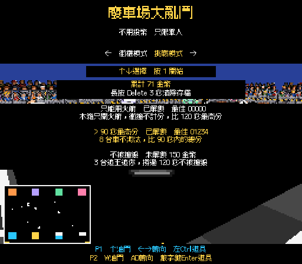
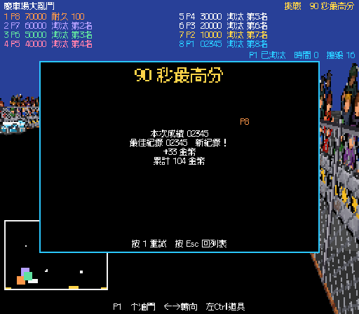

# 票單 11：「90 秒最高分」驗證

日期：2026-11-10（Asia/Taipei）。正式場景：`Assets/Scenes/GAME3_Mode7.unity`。開工提交：`9a1e772`。

挑戰使用 8 台車，90 秒前不進行計時淘汰，90 秒整依分數結算八個名次；同分沿用耐久、座位順序。一般撞毀扣 250 分並於 3 秒後重生。沿用票單 12 的 150 金幣解鎖，以及票單 10 的免費單人開局、最佳紀錄、結算與重試流程。

## 驗證結果

| 檢查 | 結果 |
| --- | --- |
| TDD | 使用者確認公開 `Challenge`／`DemolitionMatch`、`ChallengeRecords`／`GoldWallet` 邊界。第一個測試原先失敗（預期 8 台，實際 4 台），補規則後通過 |
| 90 秒邊界 | 89.75 秒仍有 8 台、沒有淘汰事件；90 秒整結束，八個名次依分數排序，玩家紀錄取自己的分數 |
| 撞毀 | 扣 250 分後仍留在挑戰，3 秒後重生，不立即結算 |
| 挑戰相關 EditMode | 26／26；含兩個付費挑戰的不足金幣、扣款、存檔、避免重複扣款、清存檔上鎖與最佳紀錄保存 |
| 完整測試 | Unity CLI `run_tests --mode all`：119／119，無略過或失敗；預設排除 Explicit 測試 |
| 正式場景流程 | `tmp/ticket11-play.cs`：28 項通過。倒數不耗比賽時間、8 台／7 AI、撞毀與重生、89.75 秒仍留場、90 秒結束、AI 冠軍時仍記錄玩家分數 |
| 金幣 | 玩家 1234 分第 8 名，得到 10＋12＝22 金幣；結算繼續推進不再發放；下一局 1000 分得到自己的 20 金幣，保留最佳 1234 |
| 重試與返回 | 免費重試同一挑戰；20 秒後返回挑戰列表並顯示最佳紀錄 |
| 模式切換 | 不被撞毀仍為 4 台／3 追王；返回街機恢復 8 台、40 秒剩 4 台 |
| 票單 12 回歸 | 更新後的 `tmp/ticket12-verify.cs` 21 項全部通過 |
| 畫面 | 已檢視 512×448 列表與結算，挑戰名稱、條件、紀錄、金幣與重試提示可讀 |
| 編譯與 Console | 獨立副本重新編譯與網域載入完成，最後 Console 錯誤 0、警告 0 |

規則修改集中在 `Challenges.NinetySecondScore`：設定 `carCount: 8`，時間表只保留 90 秒決賽。沒有新增場景物件或畫面文字。同步移除 `tmp/ticket12-verify.cs` 中「90 秒挑戰尚未實作」的過時斷言。

驗證副本由開工提交的 Assets／Packages／ProjectSettings 加上本票程式建立，位於 `C:\Users\a0900\AppData\Local\Temp\TNDA-ticket11-20261110`，產品名稱為 `TNDA Ticket11 QA 20261110`，與使用者金幣及紀錄存檔隔離。流程透過公開 `Advance` 推進模擬時間，沒有等待 90 秒實際時間或人工鍵盤操作。畫面擷取暫時使用相機渲染既有 HUD，完成後還原 Canvas；主場景未修改。CLI 狀態查詢曾產生不支援 `editor status` 的工具錯誤，確認來源後清除，後續測試及最終 Console 正常。

## 審查

固定點 `9a1e772`，審查快照 `f472bb0`。兩位獨立代理分別審查 Standards／Spec。

Standards：0 項硬性違規，0 項需修正的程式碼異味。執行期修改集中於既有規則入口，測試使用公開介面與獨立存檔，未新增重複產品文字或手動修改 Unity 資產。

Spec：0 項發現。8 車、90 秒結算、解鎖與保存、撞毀重生、P1 紀錄、金幣只發一次及模式切換符合票單，未新增額外功能。

主 Editor 由另一票單使用，CLI 查詢逾時；本票採獨立副本完成編譯與驗證，最後已停止 Play Mode。主工作區其他票單的程式與場景改動不包含在本票提交；Windows／Web 發行檔未重建。
