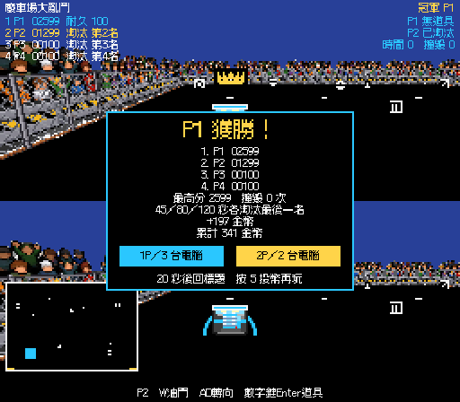
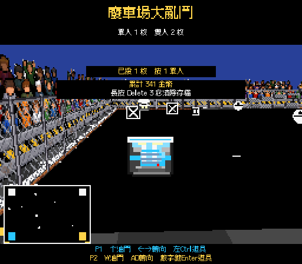
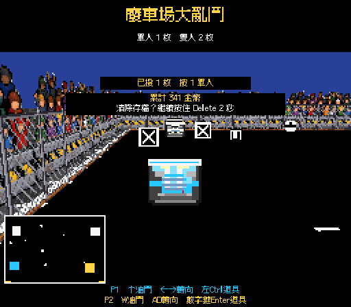

# Mode 7 票單 09：金幣與存檔

日期：2026-11-09（Asia/Taipei）。規格：`.scratch/mode7-expansion/issues/09-gold-and-save.md`。

`GoldWallet` 保存獨立於投幣硬幣的本機金幣。第 1 名 100、第 2 名 60、第 3～4 名 30、第 5～8 名 10，再加上分數除以 100 無條件捨去。雙人兩份獎勵加入同一個錢包；電腦車與待機示範不領獎。

正式比賽決定冠軍時立即發獎並儲存，真人勝利圖與後續結算不會重複發獎。結算顯示本局「+N 金幣」與累計總數。真人全部淘汰且未繼續時，在原本的 GAME OVER 面板顯示金幣獎勵，維持 2 秒後回標題的流程。投幣繼續尚未結束一局，不先發獎；Esc 中止比賽也不發獎。

標題顯示累計金幣與「長按 Delete 3 秒清除存檔」。按住時顯示清除確認倒數；放開取消。完成後金幣與既有最高分歸零，提示放開 Delete。遊玩或結算期間按住 Delete 不會清除；在其他階段按住再回標題，也必須先放開。投幣硬幣不受領獎或清除影響。

存檔使用 `PlayerPrefs` 的 `TNDA.Gold`，每次發獎及清除均呼叫 `Save()`。最高分沿用 `WreckBest`；清除只移除遊戲的這兩個項目，沒有呼叫 `DeleteAll()`。

## 介面與場景

所有新文字定義於 `CabinetText`，已加入 Cubic 11 像素字型字元表。標題新增金幣總數、清除提示與黑色背景；結算壓縮原有空行，保留名次、最高分、淘汰規則、按鈕與返回提示。`GAME3` 與 `GAME3_Mode7` 都已接線。

`Game3Text.CreateAttractScreen()` 與 `Mode7Layout.Apply()` 保留重新修補的入口。共享場景本次以 Unity Editor API 加入三個物件與兩個參照，並調整結算文字框，未重建其他場景內容。

## 驗證

使用者已確認以公開金幣錢包介面測試計算、雙人加總、存檔重讀與清除，再以 Play Mode 驗證畫面及投幣互不影響。`GoldWalletTests` 依序完成先失敗、再通過：名次／分數、雙人錢包、重讀存檔、清除及重新領獎，14 項全部通過。測試使用唯一的暫存存檔項目，完成後清除。

主專案同時有其他工作使用 Editor，故完整回歸及畫面驗證在獨立副本進行。完整 EditMode 78 項全部通過，無跳過。`tmp/ticket09/verify.cs` 透過 `StartRun`／`TryStartRun`／`Advance` 與公開錢包介面完成 20 項檢查，全部通過：

- 待機示範跨兩輪不發獎；投幣、開局與金幣分開。
- 真人勝利時雙人各自依名次與分數領獎；勝利圖、結算及後續影格不重複領取。
- 電腦冠軍仍只發兩位真人的獎勵。
- 提早 GAME OVER 發放被淘汰真人的獎勵，回標題不重複發放。
- 遊玩期間長按無效；標題長按顯示確認、放開取消、滿 3 秒清除並保存零餘額。
- 清除最高分但保留投幣硬幣；有金幣也不能替代投幣開局。
- 文字表所有字元均有字型字形；512×448 標題、結算與清除確認截圖已檢視。

流程驗證前後還原原本的金幣與最高分存檔。

實際關閉並重新啟動獨立 Editor 行程後，專用測試錢包仍讀到原先保存的 31 金幣，確認跨行程持久保存；完成後已移除該測試項目。同步共享工作區最新渲染程式、材質與場景後，完整 PlayMode 測試 1／1 通過。

獨立副本重新編譯與網域重新載入完成，Console 即時錯誤 0、警告 0。共享主 Editor 曾有 CLI 逾時，恢復後再次明確執行 `recompile` 回報 `up_to_date`、`compiling=false`、`domainReloadInProgress=false`；已確認主場景金幣與清除標籤參照均有效、字型有新字形，Console 即時錯誤 0、警告 0。本票未停止或重新啟動共享主 Editor。

## Standards

0 項硬性違規，0 項需修正的程式碼異味。新文字、像素介面、存檔邊界及共用程式修改均符合專案規範。

## Spec

0 項發現。名次獎勵、分數捨去、共享錢包、存檔、發獎時機、結果顯示、長按確認及貨幣分離均符合票單。

審查固定點為本次開工時的 `8c4c0da`，僅審查票單 09 的差異，排除同時進行的其他修改。Standards：0 項；Spec：0 項。
