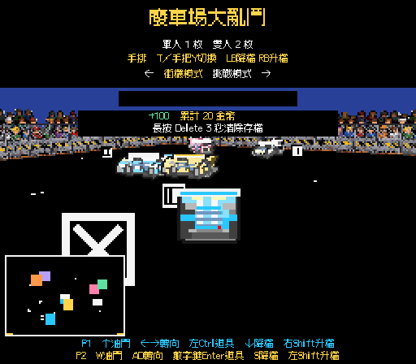
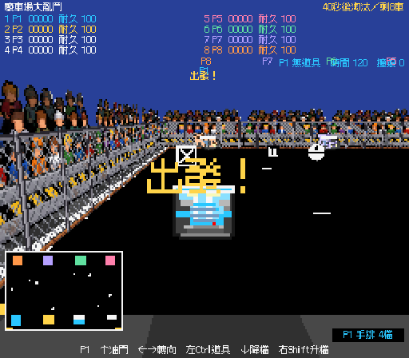
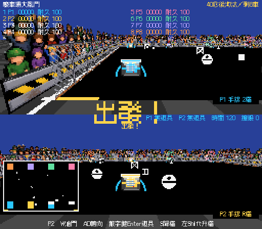

# 票單 14：手排變速箱驗證

日期：2026-11-10（Asia/Taipei）。場景 `Assets/Scenes/GAME3_Mode7.unity`，Unity 6000.6.4f1。

## 實作

- 標題 T／手把 Y 切換並保存共用手排設定。自排維持原一鍵油門曲線與 2.8 最高速，僅顯示 1～3 檔；AI 的駕駛、個性與速度倍率沿用原設定。
- 手排 P1：↓／右 Shift 降／升；P2：S／左 Shift；每支手把 LB／RB。檔位 R／1～4 的速度上限為 -1／1.2／1.9／2.5／3.0，預設加速力 1.4／2.1／1.68／1.4／0.91。僅手排加速力隨檔位改變，滑行減速不變。高檔可從靜止起步，不熄火、不扣耐久。
- 開局、一般撞毀重生、計時淘汰後付費復活皆回到 1 檔。街機與三個挑戰共用；櫻桃倍率照常。長按 Delete 清存檔一併回復自排。
- 標題選項、手排提示與玩家檔位全由 `CabinetText` 供字；字型已補齊。檔位框是 11px，1P 右下角，2P 分別放在各自半邊右下角。

## 測試與證據

使用者同意兩個公開測試邊界：`ArcadeVehicle.Drive`、`ArcadeGame` 設定保存與開局。

- TDD：`TransmissionTests` 11 項，逐輪確認限速、換檔、加速力、自排曲線與生命週期重設先失敗再通過；`TransmissionCabinetTests` 1 項，保存設定、重開場景讀取、雙人共用與新局換檔先失敗再通過。
- 公開流程 `tmp/ticket14-play.cs`：26／26。涵蓋 1P 手排、2P 手排、自排的自動操作整局流程，獨立換檔、撞毀重生、40 秒計時淘汰／投幣復活、三個挑戰倒車、清除存檔與字型。這是自動操作驗證；真人駕駛手感仍由使用者遊玩判斷。
- 真正 Input System 事件經正常 `Update`：`tmp/ticket14-input.ps1` 7／7。四個鍵盤換檔鍵、按住只換一次、兩支手把各自 LB／RB、T／手把 Y 切換。副本使用 IgnoreFocus 接收背景輸入，未變更正式專案輸入設定。
- 完整場景修補兩次：276→276，兩個檔位框與標題／操作提示參照有效。
- 結案（2026-11-10）：主 Editor 重新編譯 up_to_date；完整 EditMode 140／140 通過；Console 最新取樣 compilationFailed=false、錯誤 0、警告 0。專案沒有 PlayMode 測試組件，PlayMode 以上述公開流程自動操作驗證。

測試副本：`C:\Users\a0900\AppData\Local\Temp\TNDA-ticket14-20261110`，獨立產品名稱 `TNDA Ticket14 QA 20261110`，清存檔測試不接觸正式存檔。CLI 包裝 `tmp/ticket14-qa.ps1`。原完整測試切換 Play Mode 遇到 batch 場景儲存對話框；已將車輛測試隔離到 preview scene，重開驗證副本後於空白場景重跑。

主 Editor 最初 CLI 逾時，後來恢復連線，已以 Editor API 加入所需 UI 並儲存正式場景。票單 08 的既有變更保留，由其原代理獨立提交為 `f60598d`。本票審查以該提交為固定點。

## 畫面

本票不包含 Windows／Web 發行檔重建。
