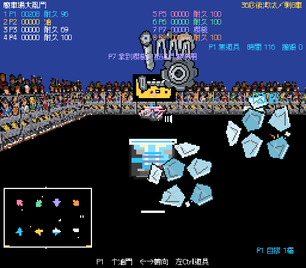
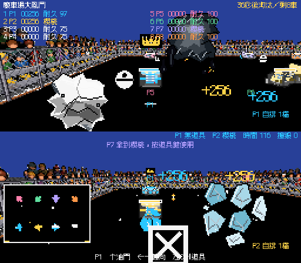

# Mode 7 小地圖箭頭與圖層驗證

日期：2026-11-15（Asia/Taipei）。需求：`.scratch/mode7-expansion/issues/19-minimap-arrows.md`。

## 實作

`Mode7Stage` 在執行期建立 16 格 7×7 箭頭，每格對應 22.5°，以車輛的實際 `heading` 選格。箭頭保持正向，不跟著追尾相機的 billboard 旋轉；每個來源像素對齊小地圖格點，再以 2 倍顯示。沿用車輛的座位色與 palette property block，因此 P3／P4 條紋及櫻桃配色保留。標記跟隨車輛生命週期：打滑、撞毀與永久淘汰的飛出期間持續轉向，車輛隱藏時一併隱藏。

小地圖相機改畫到獨立的 72×48、Point Filter RenderTexture，RawImage 固定在畫布左下 `(8,36)`、大小 144×96；四邊仍各為 1 美術像素（2 畫布像素）的白框。畫布順序為追尾美術、兩個碎片圖層、小地圖與白框、HUD。2P 時仍在 P2 半邊左下角。停用小地圖會連同白框隱藏；停用／重啟 `Mode7Stage` 會釋放並重建貼圖、箭頭與 RawImage，還原原相機設定，不留下重複標記。

## 測試與畫面

使用者已確認以公開呈現介面驗證箭頭方向、生命週期與圖層。TDD 先確認舊方塊測試失敗、共用美術貼圖尺寸測試失敗，以及未對齊的箭頭為 6.227 像素；完成各步後對應測試通過。

- `Mode7MinimapTests`：8 台車、16 個方向與座位色、跨越 0° 的方向取整；獨立貼圖、2 倍尺寸、碎片／HUD 順序、白框與小地圖開關；淘汰旋轉、隱藏與元件重新啟用。
- 完整 EditMode：184／184 通過。
- 完整 PlayMode：4／4 通過，包含既有的各追尾畫面遮擋與還原俯視位置回歸。
- 既有 13 項升級測試原本沿用速度調整前的基準。`UpgradeDrivingTests` 明訂固定測試輸入 2.8／1.4；`GarageCabinetTests` 改用現行場景基礎速度 3.5 的滿級預期 4.2。遊戲速度與升級公式均未修改。
- 1P／2P 透過實際衝撞觸發碎片，另把一片實際碎片移到小地圖正後方，於同一幀切換顯示前後比對含白框區域：各 14,800 像素、差異 0。HUD 與小地圖皆使用實際 Canvas／相機輸出。
- 截圖為 512×448；已逐張檢視箭頭方向、座位色、P3／P4 條紋、白框，以及碎片被小地圖蓋住。幀數在設定與擷取之間持續增加。

完整測試與畫面驗證於獨立副本進行，使用不同 productName 隔離存檔；未動用使用者金幣、最高分、升級或挑戰紀錄。主專案已明確重新編譯並等待網域重新載入完成，Console 即時零錯誤、零警告，完成時停止 Play Mode。CLI 的 `status --until-ready` 與舊 Pipeline 組合曾留下 `editor status` 不存在的診斷；確認屬工具呼叫後清除，再檢查正常渲染期間與主專案 Console，均為零錯誤、零警告。

本次交付 Unity 專案，未重建 Windows／Web 發行檔。保留工作目錄中的其他未提交修改。

## Standards

0 項發現。核對 `AGENTS.md`、`AGENT.md`、`GLOSSARY.md` 與 ADR 0001，未發現明定規範違規或可行動判斷項。未手動修改場景／Prefab／資產 YAML；小地圖保持 2×2 粗像素；沒有新增分散的畫面文字。

## Spec

0 項發現。16 方向箭頭、配色與條紋、飛出期間轉向、獨立小地圖、碎片與 HUD 排序、2 倍像素與白框均符合需求；既有升級測試修正是完成完整測試的必要維護。

雙軸審查固定點 `ac0a577`，程式碼快照 `cf58e513`。Standards 0 項、Spec 0 項，兩軸皆無待修正問題。
