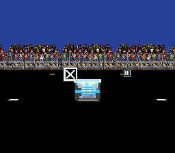
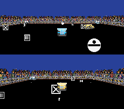
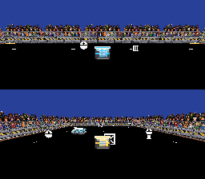
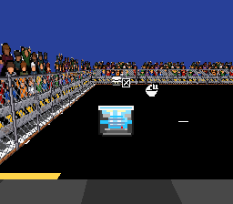

# Mode 7 票單 05：觀眾席與鐵絲網

日期：2026-11-09（Asia/Taipei）。規格：`.scratch/mode7-expansion/issues/05-crowd-and-fence.md`。

四邊固定直立的圍欄與外側觀眾席由 `Mode7Audience` 建立，僅追尾相機顯示，小地圖不顯示。使用兩個 MeshRenderer，共 8 個四邊形；沒有 Collider、Collider2D 或新的比賽實體。`DemolitionGame.WreckPresented` 只通知撞毀呈現，不改傷害、計分、AI 或淘汰流程。

一般時在前兩格間切換，觀眾輕跳 1 個素材像素；撞毀時使用後兩格、跳動 2 個像素，持續 1 秒。護欄保持原位。相機退到場外時，近側牆的背面不繪製，避免整個畫面被近處觀眾遮住。

## 素材與重跑入口

使用者提供的兩張原圖保留為 `Assets/Prototype/Game3/Art/Source/Mode7CrowdSource.png` 與 `Mode7FenceSource.png`。

- `Mode7Crowd.png`：384×64，三格各 128×64，共同裁切範圍與基線；移除與邊緣連通的白底，保留白色衣服。
- `Mode7Fence.png`：32×48，保留原圖立柱、橫桿與鏽色底座；依原圖菱形線路重建透明網眼。
- 兩張圖均為 Point Filter、無 Mipmap、無壓縮；材料直接參照專用 Cutout Shader，會隨場景進入建置。
- 開啟 `GAME3_Mode7`，執行選單 **TNDA / Mode 7 / Apply crowd and fence** 可重建素材與接線。重跑沿用現有元件與材料，保留 Inspector 調整值；完成後儲存場景。

## 驗證

環境：Unity 6000.6.4f1、Pipeline 0.8.0-exp.1、Unity CLI 1.0.0-beta.17。

主 Editor 一度因背景狀態而使 CLI 逾時，因此 Play Mode 與完整測試在工作區資產的獨立驗證副本進行。最後重新連線主專案確認：`recompile_status` 為 `up_to_date`、`failed=false`，Editor `compiling=false`、`domainReloadInProgress=false`；Console 即時錯誤 0、警告 0。已還原主專案的背景執行設定，並清除本票產生於 Assets 的暫存截圖。

| 檢查 | 結果 |
| --- | --- |
| `DemolitionMatchTests` 單檔 | 33 / 33 通過 |
| 完整 EditMode 測試（包含工作區當時的車數與混合解析度測試） | 54 / 54 通過，無跳過 |
| 一般觀眾動畫 | 觀察到第 0、1 格交替 |
| P1、P2、兩台電腦車撞毀 | 每台皆出現第 2 格激烈歡呼，1.2 秒時皆恢復一般動畫 |
| 待機示範撞毀 | 同樣歡呼；5 次撞毀共收到 5 次呈現通知 |
| 裝飾的物理元件 | Collider 0、Collider2D 0 |
| 小地圖 | 排除觀眾與圍欄圖層 |
| 1P、2P、待機，以及東南西北方向 | 已檢視實際追尾相機 RenderTexture；網眼透明，接角連續，觀眾在網外 |

以下是遊戲使用的 256×224 美術層，不含 HUD；混合解析度會將它以 2 倍顯示。

固定相同畫面，交錯開啟／關閉裝飾各 6 次，每次呼叫 40 輪相機渲染，取每輪提交耗時中位數：

| 畫面 | 關閉裝飾 | 開啟裝飾 |
| --- | ---: | ---: |
| 1P | 0.238 ms | 0.219 ms |
| 2P | 1.491 ms | 1.408 ms |
| 待機 | 0.289 ms | 0.264 ms |

取樣未見明顯耗時增加；差異落在環境波動範圍。這是固定場面 `Camera.Render` 的提交耗時，不能當作實機 FPS 提升的證據。

## Standards

0 項硬性違規，0 項需修正的啟發式問題。變更限於呈現層；素材保留原圖，場景與材料由 Editor API 建立，套用工具可重跑。

## Spec

0 項發現。四邊直立圍欄、外側觀眾席、透明網眼、一般跳動、任意車輛撞毀後約 1 秒的同步歡呼均已對應實作。最終背面剔除與像素跳動也已複查。

Standards：0 項；Spec：0 項，兩軸皆無需修正項目。
