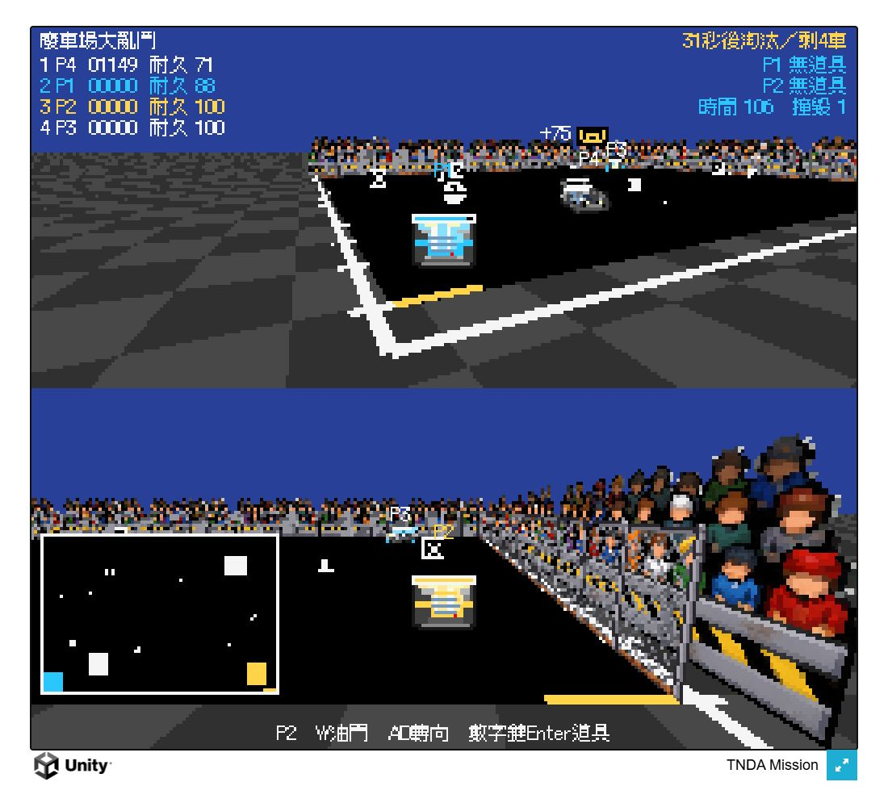
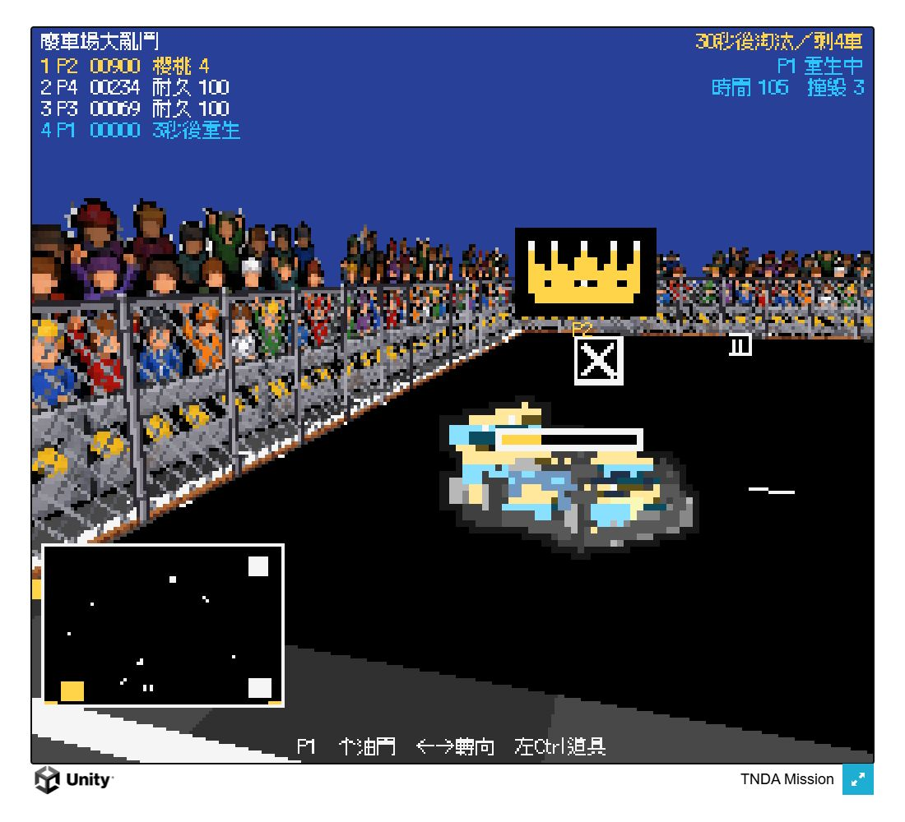

# Mode 7 正式主場景：票單 03

日期：2026-11-09（Asia/Taipei）。程式提交：`a47160b`。規格：`.scratch/mode7-expansion/issues/03-mode7-main-scene.md`。

Windows 與 Web 的第一個、唯一建置場景為 `Assets/Scenes/GAME3_Mode7.unity`；俯視版 `GAME3` 留在專案。畫布為 512×448，美術層為 256×224，預設視窗／網頁畫布為 1024×896。

站立物件各用一個 SortingGroup，保留內部圖層；所有組的外層排序同為 10，高於地面標記 1 與油漬 3，再由各追尾相機依距離排序。車尾道具獨立排序；兩台相機使用同一份地面位置快照，小地圖渲染時還原俯視姿態與原排序。

地面與場地地板使用場景直接參照的 `Mode7Ground.mat`／`Mode7Ground.shader`。執行期只複製材質、產生紋理與無碰撞元件的四邊形網格，停止時清理；不再搜尋內建 `Unlit/Texture`。建置前接線可由 **TNDA / Mode 7 / Promote to main scene** 重跑，拒絕覆蓋未儲存場景。

## 輸出

- Windows：`C:\Users\a0900\Downloads\TNDA Mode7\Windows\TNDA Mission.exe`。
- Web：`C:\Users\a0900\Downloads\TNDA Mode7\Web\index.html`，搭配同目錄的 `Build/` 與 `TemplateData/`；Gzip 加 Decompression Fallback，需以靜態伺服器開啟。
- 舊的 `Downloads\1016\`、`1016.zip` 與 `Downloads\TNDA web\` 未覆蓋。

正式輸出不包含驗證副本中的 `Ticket03Smoke.cs` 或 `.jslib`。建置成功、沒有建置錯誤；Windows 有兩項工具鏈警告：Pipeline Runtime 未啟用，以及 TMP 套件 shader 的舊 pragma。這與下述主 Editor 即時 Console 零警告分開記錄。

## 驗證

環境：Unity 6000.6.4f1、Unity CLI 1.0.0-beta.17、Pipeline 0.8.0-exp.1。

| 檢查 | 結果 |
| --- | --- |
| 最終完整 EditMode | 86／86 通過，沒有跳過 |
| 實際相機渲染整合測試 | 1／1 通過；六類站立物件各從兩個相反視角比對遮擋像素，另驗證小地圖位置與排序還原 |
| 地面白線回歸 | 保留場景真實 `Floor marking`，先重現白線穿車的失敗，再確認修正後車身蓋住地面 |
| 建置設定／shader 依賴 | 原設定兩項失敗，切換場景與接線後通過；shader 是場景的遞迴資產依賴 |
| Windows 測試建置的完整流程 | 21 項通過，含地面 shader 存在且支援、待機示範、投幣、1P／2P、倒數、120 秒比賽、勝利、結算返回、淘汰後投幣繼續 |
| WebGL 測試建置的完整流程 | 同樣 21 項通過；瀏覽器沒有執行期錯誤 |
| 正式 WebGL 鍵盤操作 | 按 5 投幣、1 單人、Esc 返回、再投入兩枚並按 2 雙人，均有實際畫面反應；觀察到比賽計時、AI 移動與分數變化 |
| 正式 WebGL 尺寸 | Canvas 實際 1024×896；已檢視黑色場內地板、外側棋盤地面、1P 與 2P 上下分割 |
| 正式 Windows | 建置成功並啟動原生 DX11 視窗，Player.log 沒有例外或 shader 錯誤 |
| 主專案最終狀態 | `recompile_status=up_to_date`、`failed=false`、`compilationFailed=false`；Console 即時錯誤 0、警告 0；停止 Play Mode，場景未修改，背景執行設定還原為 false |

測試建置透過遊戲既有公開介面 `Advance` 推進模擬時間，固定分數以確實走到決賽、勝利及結算；不是等待 120 秒實際時間。正式版另以上述鍵盤操作確認沒有驗證程式仍可正常進入單／雙人遊戲。

最初 WebGL 實測發現 `CreatePrimitive(Quad)` 嘗試建立已被剔除的 MeshCollider，產生兩個錯誤；改為直接建立 MeshFilter／MeshRenderer 後重建，錯誤消失。WebGL 存檔時仍有 Unity 的 `JS_FileSystem_Sync` 棄用提醒，沒有執行期錯誤。

Windows 視窗擷取工具持續回報逾時，未將其當作視覺驗證證據；Windows 流程與 shader 支援由實際測試建置確認，下面的視覺證據來自正式 WebGL 與相機渲染測試。

## 測試紀錄的副作用

第一次 Windows 流程驗證誤用正式版的本機紀錄位置，將 `WreckBest` 寫成 50000；舊值沒有備份，無法精確還原。測試新增的 1290 金幣可確認原值為 0，已還原為 0。此事已告知使用者；後續正式版檢查沒有再以固定分數完成比賽。

## Standards

0 項硬性違規，0 項需修正的啟發式問題。場景與材質由 Editor API 產生，修補入口保留既有調整值；材質、紋理、網格與排序組有清理；測試觀察真實相機渲染結果。

## Spec

初審 1 項：站立組預設排序 0，會被排序 1 的地面白線蓋住。已將所有站立組統一設為 10，加入能先失敗再通過的白線回歸，複查與最終渲染測試通過。其餘 shader 參照、唯一建置場景與雙相機距離排序沒有未解問題。

使用者確認的起點為 `8c4c0da`；期間其他票單各自提交，03 的最終獨立差異為 `a17e53b...a47160b`。

Standards：0 項；Spec：0 項未解，兩軸皆無待修項目。
