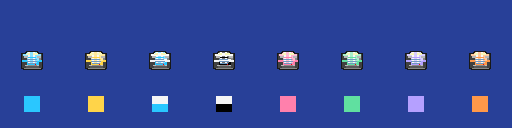
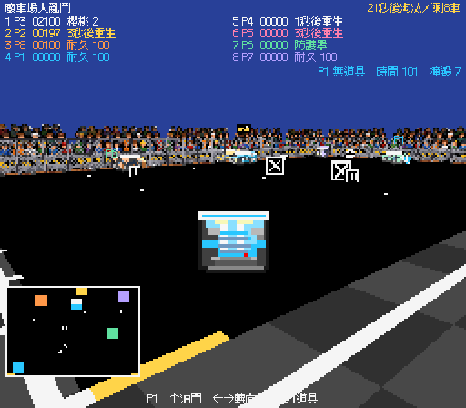
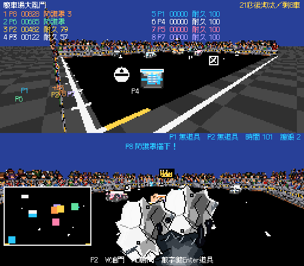
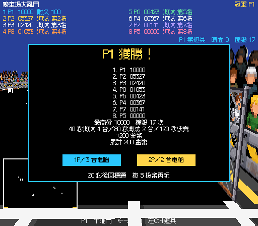

# 票單 07：8 台車金字塔淘汰驗證

日期：2026-11-10（Asia/Taipei）。正式場景：`Assets/Scenes/GAME3_Mode7.unity`。

街機模式與待機示範擴為 8 台車；40 秒淘汰最低分 4 台，80 秒再淘汰 2 台，120 秒決賽。同分先比耐久，再淘汰較高座位。火箭／油漬共用 4 個名額，破壞物維持 5、道具木箱維持 4，取消舊活動實體上限。

## 驗證結果

| 檢查 | 結果 |
| --- | --- |
| TDD：正式場景的淘汰時間表 | 初次失敗（只有 4 台車）；擴充場景後通過 |
| TDD：雙人 AI 分配 | 初次失敗（迷糊只有 1 台）；8 座位表修正後通過 |
| 新增 EditMode | `Mode7PyramidTests` 7／7：40／80／120 秒、分數／耐久／座位同分順序、1P／2P／示範個性、出生與同時重生間距、混合火箭／油漬池及第 5 個道具保留 |
| 票單 07 獨立完整 EditMode | 102／102；含票單 06 原四車固定亂數回歸 |
| 與已提交票單 12 整合後完整 EditMode | 112／112；保留挑戰解鎖、耐久成績及追王限定玩家的規則 |
| PlayMode 渲染回歸 | 1／1；雙相機遮擋與小地圖還原 |
| 1P 完整比賽 | 16 項通過：8 台、4 個道具名額、8 台排行榜、40 秒剩 4、80 秒剩 2、120 秒冠軍、勝利後結算 8 名與正確規則 |
| 2P 完整比賽 | 同樣 16 項通過，雙視角與上下分割正確 |
| 挑戰／街機切換 | 6 項通過：既有火箭挑戰仍為 4 台，隱藏額外車與排行榜列；回街機恢復 8 台及 40 秒淘汰 |
| 待機示範 | 4 項通過：8 台 AI、20 秒示範第一段淘汰、30 秒迴圈恢復 8 台、無缺字 |
| 座位辨識 | 已檢視 8 台追尾車圖及相同小地圖標記；P3／P4 的條紋保留，P5～P8 分別粉紅、薄荷綠、紫、橘 |
| 場景修補可重跑 | 連續兩次修補皆為 267 個物件；8 台原車輛參照、速度與重生時間保留，場景已儲存 |
| 主 Editor | 重新編譯及網域重新載入完成；即時 Console 錯誤 0、警告 0，停止 PlayMode |

完整流程使用 `tmp/ticket07-play.cs`，透過遊戲既有公開 `StartRun`／`Advance` 推進 **120 秒模擬時間**。前 20 秒送入油門、轉向與道具輸入，後續固定真人的領先分數，確實走完兩次淘汰、決賽與結算；不是人工鍵盤操作或等待 120 秒實際時間。共 42 項流程檢查通過。

驗證在獨立副本進行，使用獨立產品名稱隔離本機紀錄。主專案保留原有未提交的素材刪除、`GAME3.unity` 與 Player Settings 改動；後兩者以檔案雜湊確認未變。另項票單 12 於過程中獨立提交，07 再針對合併後程式完成完整回歸。Windows／Web 發行檔未重建。

批次 Editor 沒有 Game View 渲染目標，畫面由 `tmp/ticket07-capture.cs` 暫時把實際 HUD 畫布交給相機，在 512×448 擷取後還原；美術使用原本的 Mode 7 渲染紋理。`tmp/ticket07-palette.cs` 使用正式車圖、材質與屬性繪出下列配色對照，從左到右為 P1～P8，上排追尾車圖、下排小地圖標記。

## Standards

0 項硬性違規，0 項未解問題。新畫面文字集中於 `CabinetText`；規則透過 `DemolitionMatch` 公開介面測試；場景由 Editor API 擴充。最終複查發現一處輕微驗證標籤誤述，已把「起點分離」改為實際檢查的「8 個座位名稱唯一」；起點與重生間距由 EditMode 另行驗證。

## Spec

0 項發現。淘汰時間、同分順序、AI 分配、座位辨識、出生／重生間距、道具名額、8 台排行榜及結算符合票單。雙人同時淘汰的各自分割繼續面板留給票單 08。

審查起點為開工提交 `6dbc358`，使用票單 07 獨立快照 `e7ac097` 分別執行 Standards／Spec 審查；最終提交保留其後票單 12 的 `309597e` 改動。
