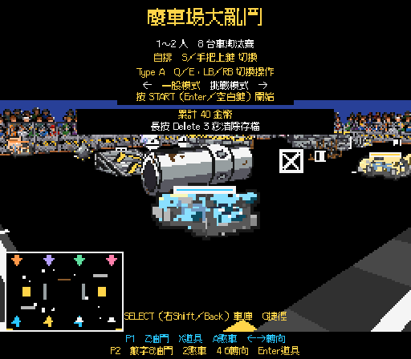
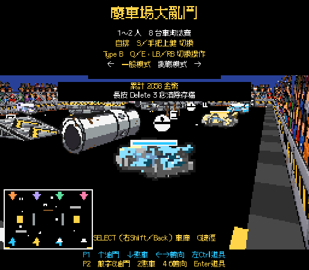
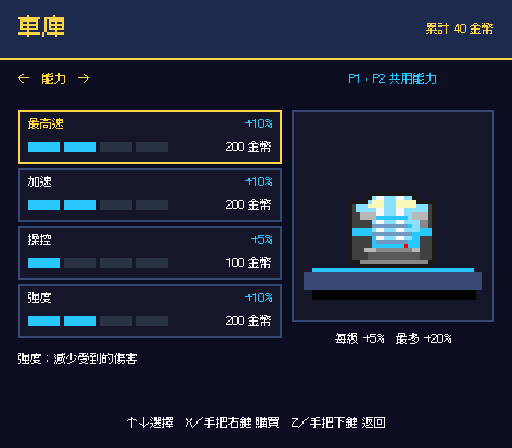
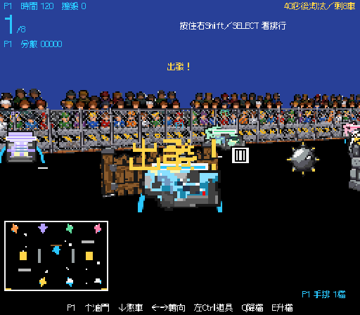

# SFC 操作與 Type A／B

日期：2026-11-16（Asia/Taipei）。規格：`.scratch/mode7-expansion/issues/24-sfc-controls.md`。

預設 Type A 使用 SFC 按鈕位置：手把下鍵油門、右鍵道具／確認、左鍵煞車，上鍵在標題切換手排／自排。P1 鍵盤對應 Z、X、A、S；方向鍵轉向、Q 降檔、E 升檔。Type B 保留 ↑ 油門、左 Ctrl 道具、手把左類比／十字鍵往上油門、下鍵道具；↓ 或類比／十字鍵往下煞車。P2 鍵盤仍為數字 8 油門、2 煞車、4／6 轉向、數字 Enter 道具、−／＋換檔。兩支手把各自控制自己的席位，使用共用 Type。

標題以 Q／E 或 LB／RB 切換 Type，存入 `TNDA.ControlType`；長按 Delete 清存檔時回到 Type A。S／手把上鍵切換共用手排／自排，保留 T 捷徑。Enter／空白鍵／Start 開始，Type 對應的確認鍵也可開選單、開始或在結算重玩。Type A 的 Z／手把下鍵返回，Type B 使用 Esc／手把右鍵。比賽中 START 不暫停；Esc 沿用回標題功能。

車庫由 SELECT（P1 右 Shift、P2 數字 0、任一手把 Back／View）開啟，G 保留捷徑。手把面板鍵不再開車庫。比賽中 SELECT 繼續沿用票單 23 的各席位排行榜。標題、車庫與比賽底部操作提示依 Type 更新，所有文字集中在 `CabinetText`。

煞車優先於油門，以每秒 8 單位減速，快於放開油門滑行。自排會先到零速，繼續按住才倒車；倒車上限與手排 R 檔相同（基準最高速 2.8 時為 1.0，沿用原本最高速加成比例），放開後滑行停住。手排只在 R 檔按油門倒車，煞車不切換檔位。AI 的輸入與自排行為不變。

## 驗證

使用者確認公開測試介面：`ArcadeGame.ReadInput`、`ArcadeVehicle.Drive`、`ArcadeGame` 設定與清存檔流程。讀鍵、煞車、自排倒車與設定清除均先確認測試失敗，再完成實作。新增輸入測試 9 項、煞車／倒車測試 4 項、設定保存／清除測試 1 項；原換檔測試 11 項通過。

實際 Unity Update 路徑使用模擬鍵盤與兩支模擬手把，Type A／B 各走過標題→車庫→比賽→結算，共 57 項具名檢查通過、480 幀持續前進。涵蓋第二支手把選單、類比選擇人數、確認／購買／返回、兩席位加速、START 不暫停、比賽中 Q／E 換檔且不切 Type、各 Type 操作提示與字型完整性。加速流程在暫時移除固定障礙物的執行期場地確認，避免撞牆干擾輸入檢查；原場景資產未改動地形。

截圖已逐張檢視，字型字元完整、控制提示寬度符合 512×448 原生像素版面。場景只增加必要 UI 接線與文字，不儲存預覽初始化產生的隨機破壞物位置和暫時特效。原工作區的 Q 降檔／E 升檔修正符合本票規格，已保留整合。

完整 EditMode 226／226、PlayMode 4／4 通過。重新編譯成功，`compilationFailed=false`、`compiling=false`、`domainReloadInProgress=false`，Console 即時零錯誤、零警告；結束時停止 Play Mode 並開啟正式 Mode 7 場景。

測試前備份金幣、最高分、升級、挑戰紀錄／解鎖、手排與 Type 設定，測試後逐鍵確認還原，模擬裝置也已移除。完整測試初次遇到未儲存場景提示，已取消、將記憶體場景另存備份後從空白場景重跑；最終正式場景已重新開啟且沒有未儲存變更。手把驗證使用模擬裝置，尚未接上實體手把硬體。Windows／Web 發行檔未重建。

## Standards

初審硬性違規 0 項，發現車庫測試既有的挑戰存檔備份鍵名錯誤 1 項：改成 `TNDA.Challenge.<id>.Best`／`.Unlocked`，避免新增的清存檔測試刪除使用者紀錄而無法還原。修正後覆查剩餘發現 0 項。文字、像素字型、公開測試介面與 Unity API 場景修改符合專案規範。

## Spec

0 項發現。Type A／B 對應、SELECT 車庫、煞車與自排倒車、設定保存與清除、P2 共用手把配置及數字鍵盤保留、動態操作提示與不暫停皆符合票單。AI 沿用原輸入與自排流程。

Standards 0 項未解、Spec 0 項。固定點 `47df8c9`；審查快照 `refs/codex/reviews/ticket24`，測試備份修正已由規範審查代理覆查。

