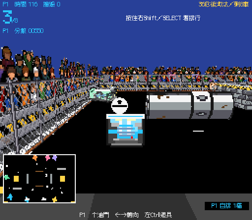
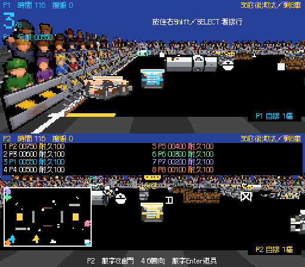
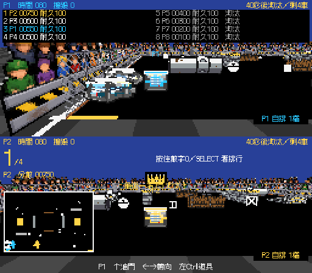

# Mode 7 按住 SELECT 顯示排行榜

日期：2026-11-16（Asia/Taipei）。需求：`.scratch/mode7-expansion/issues/23-leaderboard-on-select.md`。

一般畫面改成每個席位自己的 33px 名次、11px 存活車數分母與分數。P1 按住右 Shift、第 1 支手把 Back／View，P2 按住數字鍵盤 0、第 2 支手把 Back／View，在自己的畫面展開完整名次、車名、分數與耐久，放開收起。表格以兩欄各四列放在天空區，淘汰者保留最終名次並灰顯；存活者的名次同分時依耐久、座位排序，與淘汰規則一致。淘汰後分母隨存活車數減少；自己已淘汰時顯示「淘汰 第 N 名」。

`Mode7StandingsHud` 的 `Auto Show Before Elimination` 預設開啟、`Auto Show Seconds` 預設 5；時間歸零或關閉選項時不自動展開，SELECT 仍有效。倒數階段保留自己的名次／分數，標題、車庫、勝利、GAME OVER 與結算不顯示這組介面。時間、淘汰倒數各畫面各一份；雙人提示列往下移，避開完整排行榜。

`Editor/Mode7StandingsLayout.Apply` 增量建立兩組 uGUI／TextMeshPro，重複套用不增加物件，也保留自動展開設定。`Mode7Layout.Apply` 會沿用接線。原共用 HUD 保留給俯視參考場景；新文字集中於 `CabinetText`，使用原生像素字型與 11px 倍數字級。

## 驗證

使用者確認玩家輸入、各畫面顯示狀態、名次／分數文字為公開測試邊界。新增 `SelectInputTests` 2 項、`StandingsHudTests` 4 項。暫停 SELECT 接線時，鍵盤／手把兩項測試均失敗；暫停按住顯示時，席位表格測試失敗；恢復後全部通過。輸入測試使用官方 `InputTestFixture`，還原原輸入系統與裝置；場景測試在預覽場景執行並還原存檔。

- 完整整合 EditMode：212／212 通過，包含本次 6 項及票單 21 的刺球回歸。
- 完整 PlayMode：4／4 通過。
- 實際遊戲 Update 路徑以模擬鍵盤／手把確認兩位各自的 SELECT 按住及放開，不代表已測試實體手把硬體。
- 34.99 秒時不自動展開，35.01 秒兩畫面自動展開；關閉選項立即收起；40 秒後分母從 8 改為 4，完整表格的四台淘汰車灰顯。
- 512×448 的 1P、2P、淘汰後畫面已逐張檢視；設定與擷取間幀數有持續增加。`CabinetText` 全部字元均存在於字型。
- 主專案已重新編譯並確認網域重新載入結束，`compilationFailed=false`、`compiling=false`，Console 即時零錯誤、零警告，完成時停止 Play Mode。

驗證副本位於 `C:\Users\a0900\AppData\Local\Temp\TNDA-ticket23-20261116`，使用獨立 productName 隔離存檔。第一次主 Editor 測試遇到未儲存場景對話框，已取消切換並保留變更，重新整理後恢復編譯；完整測試在獨立副本完成。副本曾出現 Visual Studio UDP 通訊埠被另一個 Editor 占用的警告，以及 CLI 舊命令名稱診斷，確認來源後清除並複查。沒有更改使用者金幣、升級或紀錄，未重建 Windows／Web 發行檔。

期間票單 21 同時提交；共用 `DemolitionGame` 的 return、方法邊界、初始化與清理區塊在提交中交錯，保留工作區正確版本，避免已提交版本的不可編譯區塊與漏套 tuning。場景也保留刺球接線。原先未提交的 Q 降檔／E 升檔與操作提示修正保留在工作區，未納入本次提交。

## Standards

0 項發現。核對 `AGENTS.md`、`AGENT.md`、`GLOSSARY.md` 與 ADR 0001，新增測試使用公開介面並還原裝置及存檔；整合修正維持正確方法邊界與 tuning 套用位置。

## Spec

0 項發現。SELECT、各畫面獨立顯示、完整八車、灰顯淘汰、名次／分數、存活分母、可關閉的自動展開均符合票單。票單 21 的共用區塊修正屬必要整合。

Standards 0 項、Spec 0 項；固定點 `c8cab3c`，最終程式審查目標 `refs/codex/reviews/ticket23`。
